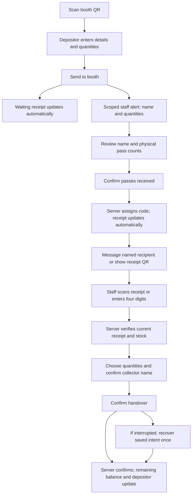

# SharePass workflow review — 14 November 2026

One product: preserve the approved black/red/silver web design; native surfaces use the same artwork, labels, action hierarchy and clearly separated targets. WhatsApp actions are green with a local logo and a named Message button when a contact is available. The message remains a draft for the sender to review.

| Friction or mismatch | Change or retained optimization |
|---|---|
| Web Collect lacked the app's keypad and camera | Both are available. Four digits trigger verification after a short pause; Scan validates a current receipt and opens its matching server-verified record. Manual code and receipt-link fallbacks remain. |
| Repeated Find passes tap | Automatic verification removes it after complete four-digit entry. Explicit Find remains for keyboard access and retries. No handover is automatic. |
| Retyping depositor/collector details | Existing customer QR intake and remembered receipt recipients retained; named WhatsApp actions reuse them. No request for contacts permission. |
| Unhelpful generic alerts | Authenticated queue refresh supplies names, category counts and administrator messages. Push provider receives only an opaque wake-up type. Revoked sessions show no private details. |
| Closely packed native actions | Shared action margins, keypad gaps and responsive labels are checked on normal and large text layouts. Unrelated sections stay visually grouped. |
| Quiet/inconsistent feedback | Short opening/tap/scan/status cues; successful custody cue only after confirmed server response. Web starts audio after a user gesture. Native respects silent/DND; both offer mute. OS notification sound/permission remains authoritative. |
| Repeating confirmation screens | Current web/native ticket intake already has one receipt-confirmation screen; current pickup already has one quantity/name-confirmation/handover screen. Legacy shelf-based workflows retain required shelf input. |
| Refreshing or checking for results repeatedly | Existing automatic waiting receipt refresh, push invalidation, visible queue fallback and background pause retained. |
| Sending an update without a contact | Native hides an unusable depositor update action when no contact exists; completed records remain readable. |

The two physical confirmations remain deliberate: staff receive passes, then staff hand over selected quantities. A four-digit lookup never overrides current receipt identity on reused codes, current stock, permissions or an existing pending operation. Recovery retains original request IDs and frozen quantities; a failed message never blocks recorded handover.

For today's demonstration use clearly synthetic records and the existing demo mode; never seed production custody to make screenshots. Real camera, sound output and notification receipt require phone acceptance. No AI service, extra database, provider migration or billing change was added.

The web QR decoder is jsQR, pinned to upstream commit8e6a036beafa7053dd44b1b76ac578d22b1b3311 with its Apache-2.0 license; it loads only on Scan and processes camera pixels locally. Decoder SHA2563325b0888fa4745c4e6940897d8c4f426fbaae76901fcbfe1871a04e90a51655. WhatsApp glyph is from Simple Icons commit521c96fd04b0ea93034db8715eda5a4de27a58bb, with its CC0 license retained; SVG SHA2568fb209a53a61618c3483594b3e070481a35575d6aaecbe00a6fe386670c8fb1c. Android's vector uses the same path with separate arc flags for Android compatibility. Native retains ZXing.
